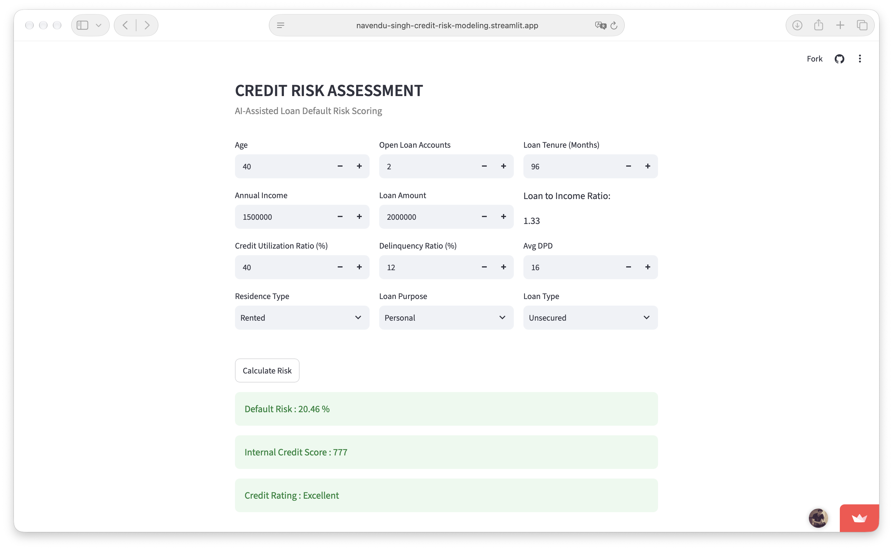
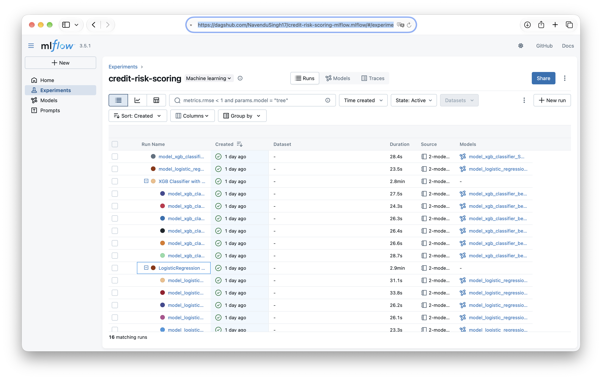

<div align="center">

# Credit Risk Modeling — Loan Default Prediction

An end-to-end machine learning project for an NBFC-style lending use case. The objective is to estimate the probability that a loan applicant will default, convert that probability into an internal credit score and rating, and make the prediction available through an interactive Streamlit application.

<p align="center">
  
  
  
  
  
  
  
  
</p>

[Open the live application](https://navendu-singh-credit-risk-modeling.streamlit.app)
&nbsp; | &nbsp;
[View MLflow experiments on DagsHub](https://dagshub.com/NavenduSingh17/credit-risk-scoring-mlflow.mlflow/#/experiments/0/runs?searchFilter=&orderByKey=attributes.start_time&orderByAsc=false&startTime=ALL&lifecycleFilter=Active&modelVersionFilter=All+Runs&datasetsFilter=W10%3D)

</div>

## Preview

#### Credit Risk Assessment for Loan Officer Review


#### Accessing the Live Application
The application is hosted on Streamlit Community Cloud. If it has gone to sleep after a period of inactivity, open the live demo link and select **"Yes, get this app back up!"** when prompted. Wait for the app to start before entering applicant details.

#### Tracked Experiments on MLflow (DasgHub)


---

## Table of Contents

- [Business Problem](#business-problem)
- [Application](#application)
- [Project Workflow](#project-workflow)
- [Feature Engineering](#feature-engineering)
- [Modeling Approach](#modeling-approach)
- [Model Selection and Evaluation](#model-selection-and-evaluation)
- [Tech Stack](#tech-stack)
- [Repository Structure](#repository-structure)
- [Run Locally](#run-locally)
- [MLflow Experiment Tracking](#mlflow-experiment-tracking)
- [Limitations and Notes](#limitations-and-notes)

## Business Problem

Loan default prediction is a binary classification problem in which the model estimates whether a borrower is likely to default:

- **0 — Non-defaulter:** the borrower does not default.
- **1 — Defaulter:** the borrower defaults.

The intended user of this application is a **loan officer** who reviews loan applications and makes the final lending decision. The model acts as a decision-support and risk-prioritization tool: it flags applicants with a higher estimated probability of default so that the loan officer can investigate them more carefully.

The business objective is to **minimize missed potential defaulters**. A false positive (a non-defaulter flagged as high risk) is acceptable to a degree because the flagged application is reviewed by a human loan officer. For that reason, the model deliberately prioritizes recall for the defaulter class over maximizing precision or overall accuracy.

### Model success criteria

The model is evaluated against the following business and credit-risk acceptance criteria:

| Success criterion | Target | Why it matters |
|---|---:|---|
| Defaulter-class recall | **> 90%** | Identify more than 90% of actual defaulters and reduce missed risky applications. |
| Defaulter-class precision | **> 50%** | Ensure that a meaningful share of flagged applicants are actual defaulters, while allowing the loan officer to review false positives. |
| KS statistic | **Must pass the credit-risk validation check** | Assess how well the model separates the score distributions of defaulters and non-defaulters. |
| Gini coefficient | **Must pass the credit-risk validation check** | Assess the model's ability to rank applicants by default risk. |

The project reports the achieved KS statistic and Gini coefficient in the evaluation section. The precise pass/fail cutoffs for KS and Gini should be set by the lending institution's model-risk policy; they are not assumed here.

**Human-in-the-loop decisioning:** the model does not approve or reject a loan. It provides risk information to assist the loan officer, who remains responsible for reviewing the application and making the final decision.

## Application

The Streamlit application accepts applicant and loan attributes and returns:

1. Estimated probability of default.
2. An internal credit score on a 300–900 scale.
3. A corresponding credit rating.

A loan officer can use these outputs as additional evidence during manual application review. A high-risk prediction is a prompt for further assessment—not an automatic rejection. This human review step makes it possible to prioritize recall and tolerate some false-positive alerts.

**Try the live application:** [Credit Risk Modeling — Streamlit](https://navendu-singh-credit-risk-modeling.streamlit.app)

The internal score is calculated from the model's predicted probability:

```text
Internal Credit Score = 300 + (1 - Probability of Default) × 600
```

The application maps the resulting score to the following illustrative rating bands:

| Credit Score | Rating |
|---:|---|
| 300–499 | Poor |
| 500–649 | Average |
| 650–749 | Good |
| 750–900 | Excellent |

These are project-defined internal score bands, not official bureau or regulatory ratings.

## Project Workflow

1. **Data preparation and EDA** — combined bureau, customer and loan-level data; inspected data quality, missing values, distributions, outliers, class imbalance and feature relationships.
2. **Feature engineering** — created borrower/loan risk indicators (`loan_to_income`, `delinquency_ratio`, and `avg_dpd_per_delinquency`) based on lending context.
3. **Feature selection** — used Weight of Evidence (WoE), Information Value (IV), correlation analysis, and Variance Inflation Factor (VIF) to assess predictive usefulness and multicollinearity.
4. **Preprocessing** — scaled numerical variables and one-hot encoded categorical variables in a reusable pipeline.
5. **Model experimentation** — trained and compared Logistic Regression, Random Forest and XGBoost approaches, with further experiments focused on Logistic Regression and XGBoost.
6. **Imbalance handling and tuning** — evaluated random undersampling and SMOTE; used RandomizedSearchCV and Optuna for hyperparameter optimization.
7. **Evaluation** — used stratified cross-validation, out-of-fold predictions and a held-out test set, with metrics suited to imbalanced classification and credit risk.
8. **Experiment tracking and deployment** — logged model parameters, metrics, reports and model artifacts with MLflow/DagsHub; exported the selected pipeline for Streamlit inference.

## Feature Engineering

The project derives risk indicators that express borrower capacity and repayment behavior more meaningfully than some raw variables considered individually.

| Engineered feature | Description |
|---|---|
| `loan_to_income` | Loan amount relative to the applicant's income. |
| `delinquency_ratio` | Delinquent months relative to loan months. |
| `avg_dpd_per_delinquency` | Average days past due (DPD) per delinquent month. |

The final model uses the following nine input features:

- `number_of_open_accounts`
- `credit_utilization_ratio`
- `age`
- `loan_tenure_months`
- `loan_to_income`
- `delinquency_ratio`
- `avg_dpd_per_delinquency`
- `residence_type`
- `loan_purpose`

Feature selection also considered Information Value and VIF. The preprocessing pipeline applies `StandardScaler` to numerical features and `OneHotEncoder` to categorical features.

## Modeling Approach

### Class imbalance

The training target is imbalanced. The training split contained 31,986 non-defaulters and 3,008 defaulters. The project evaluated alternative approaches, including random undersampling and SMOTE oversampling.

SMOTE is applied within an `imblearn` pipeline during model fitting so that resampling occurs on training folds only. The held-out test set is not resampled.

### Models and optimization

The experiments included:

- Logistic Regression
- Random Forest Classifier
- XGBoost Classifier

Hyperparameter search was explored using `RandomizedSearchCV` and Optuna. Optuna studies included objectives such as recall, F1 and F2, with particular emphasis on F2 because it weights recall more heavily than precision.

### Selected model

The exported inference artifact is a fitted **Logistic Regression + SMOTE pipeline**, tuned with Optuna to optimize F2. Logistic Regression was selected as the final model because its coefficients offer a more directly interpretable basis for explaining the direction and contribution of input features in a lending context. XGBoost was also evaluated and achieved higher defaulter precision in the reported F2-oriented comparison, but the final selection favored interpretability while meeting the project's recall and precision targets.

## Model Selection and Evaluation

Evaluation is tied to the loan-officer workflow and the stated business success criteria. Accuracy alone is not an appropriate selection metric for this imbalanced classification problem. The key operating targets are defaulter recall above 90% and defaulter precision above 50%; KS and Gini are also treated as required credit-risk model validation checks.

The project uses multiple evaluation views:

- **Stratified 5-fold cross-validation** to preserve class proportions across folds.
- **Out-of-fold (OOF) predictions** to assess training performance on held-out folds.
- **Held-out test evaluation** for an independent estimate of generalization.
- **Precision, recall, F1 and F2** for the defaulter class.
- **ROC-AUC and PR-AUC** to assess ranking/discrimination performance.
- **Gini coefficient** and **Kolmogorov–Smirnov (KS) statistic**, commonly used in credit-risk model assessment.
- **Decile/rank-ordering analysis** to examine how observed default rates change across predicted-risk bands.

### Selected model — reported test-set results

| Metric | Result |
|---|---:|
| Defaulter precision | 0.55 |
| Defaulter recall | 0.95 |
| ROC-AUC | 0.9830 |
| Gini coefficient | 0.9660 |
| KS statistic | 0.8758 |

**Business-target outcome:** the reported test-set results meet the two stated classification targets: defaulter recall is approximately **95%** (above 90%) and defaulter precision is approximately **55%** (above 50%). The model therefore identifies most defaulters while keeping the share of false-positive alerts at a level the human review process is designed to handle.

The ROC-AUC and Gini values were calculated from predicted probabilities; the KS statistic compares the predicted-risk distributions of defaulters and non-defaulters. The reported KS and Gini values are provided for credit-risk validation. Formal pass/fail status depends on the institution's approved KS/Gini thresholds, which have not been specified in this project.

> Metrics are from the notebook's reported evaluation run. Results can vary if the data split, preprocessing, library versions or training procedure change. The classification metrics above use the model's default 0.5 probability threshold unless otherwise stated.

## Tech Stack

| Area | Tools / Libraries |
|---|---|
| Language | Python |
| Data manipulation | Pandas, NumPy |
| Visualization and EDA | Matplotlib, Seaborn |
| Statistical analysis | SciPy, Statsmodels |
| Machine learning | Scikit-learn, XGBoost, imbalanced-learn |
| Hyperparameter optimization | RandomizedSearchCV, Optuna |
| Experiment tracking | MLflow, DagsHub |
| Model serialization | Joblib |
| Deployment / UI | Streamlit |

## Repository Structure

```text
credit-risk-modeling-main/
├── 1-EDA-and-feature-engineering.ipynb
├── 2-model-training-and-evaluation.ipynb
├── artifacts/
│   └── classifier.joblib
├── prediction_helper.py
├── streamlit_app.py
├── utils.py
├── requirements.txt
└── README.md
```

- `1-EDA-and-feature-engineering.ipynb` — data cleaning, EDA, feature engineering and feature selection.
- `2-model-training-and-evaluation.ipynb` — preprocessing, model training, tuning, evaluation, MLflow logging and model export.
- `artifacts/classifier.joblib` — serialized fitted pipeline used for inference.
- `prediction_helper.py` — prepares application inputs, loads the model, predicts default probability and derives score/rating.
- `utils.py` — custom transformation function required by the serialized pipeline.
- `streamlit_app.py` — Streamlit user interface.
- `requirements.txt` — pinned dependencies for running the inference application; notebook/experimentation dependencies are listed as optional comments.

## Run Locally

### 1. Clone the repository

```bash
git clone <your-github-repository-url>
cd credit-risk-modeling-main
```

### 2. Create and activate a virtual environment

Python 3.11 is the recommended version in the project requirements.

```bash
python -m venv .venv

# macOS / Linux
source .venv/bin/activate

# Windows
.venv\Scripts\activate
```

### 3. Install dependencies

```bash
pip install --upgrade pip
pip install -r requirements.txt
```

### 4. Launch the Streamlit application

Run this command from the repository root so the relative model path `artifacts/classifier.joblib` resolves correctly.

```bash
streamlit run streamlit_app.py
```

Streamlit will print a local URL in the terminal, usually `http://localhost:8501`.

## MLflow Experiment Tracking

Model experiments were tracked using MLflow with DagsHub as the remote tracking backend. The notebook logs model parameters, evaluation metrics, classification reports and model artifacts.

**Explore the experiment runs:** [MLflow on DagsHub](https://dagshub.com/NavenduSingh17/credit-risk-scoring-mlflow.mlflow/#/experiments/0/runs?searchFilter=&orderByKey=attributes.start_time&orderByAsc=false&startTime=ALL&lifecycleFilter=Active&modelVersionFilter=All+Runs&datasetsFilter=W10%3D)

## Limitations and Notes

- The raw input datasets (`bureau_data.csv`, `customers.csv` and `loans.csv`) are not included in this repository archive. The EDA notebook expects them under a `dataset/` directory. You will need authorized access to those files to reproduce the training workflow.
- The serialized model artifact is included, so the Streamlit inference application can run without retraining, provided the required dependencies are installed.
- The project is a portfolio demonstration, not a production-ready lending decision system. It is designed as a loan-officer decision-support tool with human review, not automated underwriting. Real-world deployment would require data validation, model calibration, fairness and bias assessment, explainability review, monitoring for data/concept drift, governance, security controls and compliance review.
- The KS and Gini statistics are reported, but institution-specific acceptance thresholds must be defined before claiming formal model-validation sign-off.
- The internal credit score and rating bands are illustrative project logic and should not be interpreted as a bureau score or a regulated credit rating.

---

<div align="center">

**Built by [Navendu Singh](https://github.com/NavenduSingh17)**

</div>